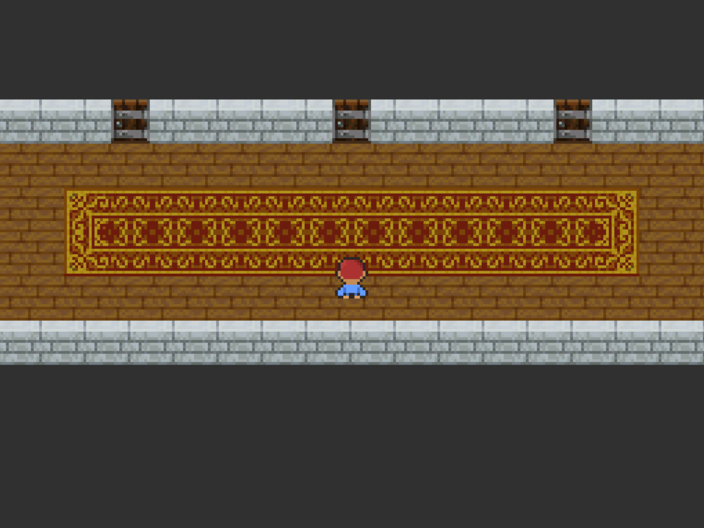
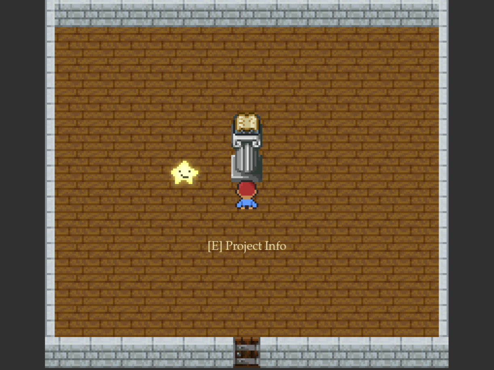
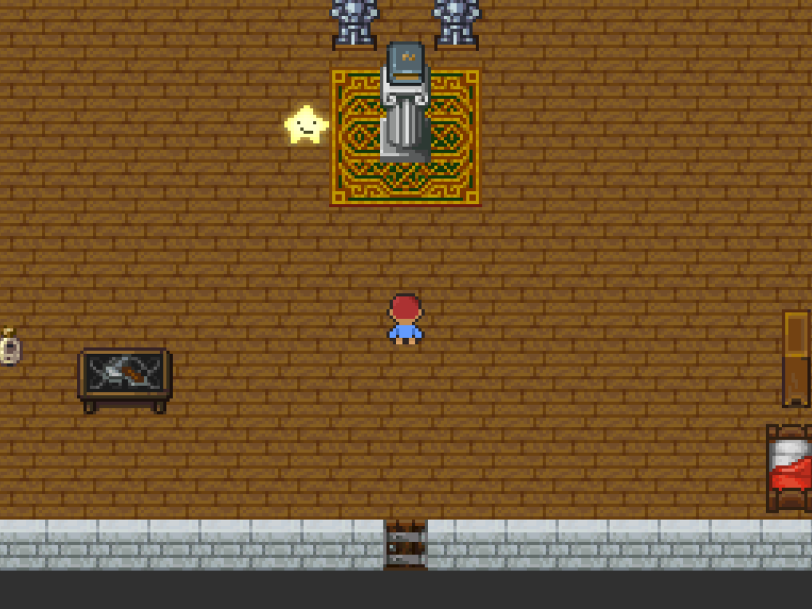

# Hall of Stars
Hall of stars is a retro 16-bit top-down "game" written entirely in Python using Pygame Community Edition. It's made for Hack Club's biggest YSWS event yet: Stardance. It transforms your project statistics into a walkable pixel-art museum. Every door represents one of your projects and behind every door lays a room filled with facts about your project. 

## Features:
- **Dynamic Project Rooms:** Every project gets its own room along the hallway. The interior is based on the total hours spent on the project.
- **Interactive NPC's and Altars:** Each room has an interactive NPC who can give you some fun facts about your project and a book with some stats.
- **Dialogues and UI:** Custom built UI logic, which provides a polished themed interaction with the game. This is the only thing in the game that's rendered in a 1024x768 resolution to be able to read the text.
- **Live Stardance Stats:** Connects directly to the Stardance Stats API to fetch real-time hours, stardust and rankings.

## Controls
| Key | Action |
| --- | --- |
| `WASD` / Arrow keys | Move |
| `E` | Interact | 
| `SPACE` / `ENTER` | Next page / Skip page |

## Screenshots




## Installation
### Pre-built Binaries (Recommended)
1. Install the right executable for your OS from the [release page](link).
2. Make sure you have the right permissions and execute the file.

### Run from source
**Linux / MacOS:**
```bash
git clone https://github.com/Camiel13/Hall-Of-Stars.git hall_of_stars
cd hall_of_stars
python3 -m venv venv
source ./venv/bin/activate
pip install -r requirements.txt
python3 main.py
```
**Windows:**
```powershell
git clone https://github.com/Camiel13/Hall-Of-Stars.git hall_of_stars
cd hall_of_stars
python -m venv venv
venv\Scripts\activate
pip install -r requirements.txt
python main.py
```